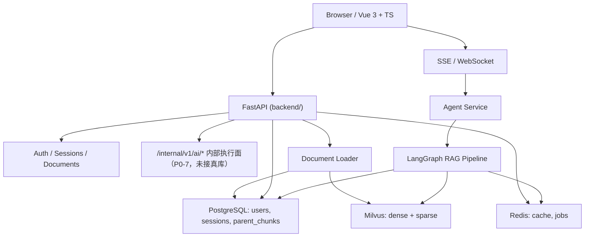
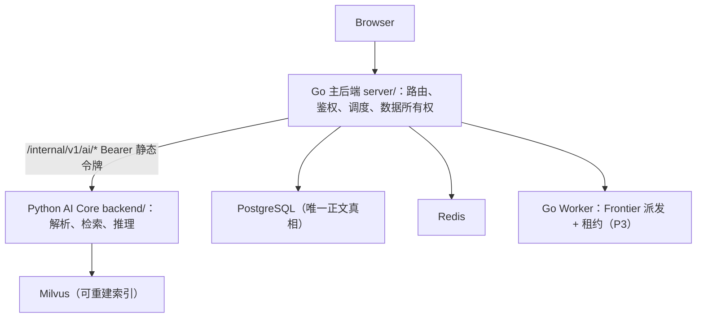

# ResearchPilot

> 2026-10-09 起按《重构执行总纲》升级为 **ResearchPilot**（旧名与决策史见 `docs/archive/`）：
> Go 主后端（调度、鉴权、数据所有权）+ Python AI Core（解析、检索、推理），
> 目标是能自主完成「检索 → 深读 → 对比 → 探索 → 核验 → 报告」的科研平台。
> **重构进行中**：当前仓库里可跑的仍是 Python 单体 + Vue 前端，Go 侧只有骨架与数据访问层。

面向学术论文的 RAG 知识库，重点处理复杂版式、公式、定理、证明、引文与多轮问答溯源。

## 0. 先读这几份（文档权威入口）

| 要知道什么 | 去哪看 |
| --- | --- |
| **最高约束**：四条第一性原则、阶段顺序律、任务卡规范、开发规范 | [docs/refactor/08-principles-and-conventions.md](docs/refactor/08-principles-and-conventions.md) |
| **产品愿景**：五个入口、十项能力、V1–V4 路线、差异化与缺口清单 | [docs/refactor/11-product-vision.md](docs/refactor/11-product-vision.md) |
| **代码问题台账**：已发现的代码层问题（证据/影响/建议/归属），按愿景检查产出 | [docs/refactor/12-known-code-issues.md](docs/refactor/12-known-code-issues.md) |
| **现在该做什么**：P0 任务卡（输入/输出/依赖/验收/证据等级）+ X1–X8 退出标准 | [docs/refactor/09-milestone-p0.md](docs/refactor/09-milestone-p0.md) |
| **进度多少 / 还差多少**：唯一真相源（`PROGRESS.md`、`progress.html` 是它的生成物） | [docs/progress.json](docs/progress.json) · [可视化看板](docs/progress.html) |
| 契约（浏览器面 / Go↔Python 内部面 / 错误码 / 表写入矩阵） | [contracts/](contracts/) |
| 目标架构（To-Be，大部分**未实现**） | [docs/refactor/02-target-architecture.md](docs/refactor/02-target-architecture.md) |
| 当前架构（As-Is 事实快照） | [docs/refactor/01-current-architecture.md](docs/refactor/01-current-architecture.md) |
| 从零起环境的命令序列 + 实跑记录 + 已知坑 | [docs/refactor/p0-environment.md](docs/refactor/p0-environment.md) |
| 文档索引与阅读顺序 | [docs/refactor/README.md](docs/refactor/README.md) |

被取代的旧计划全部移进 [docs/archive/](docs/archive/README.md)，**不作为实施依据**。
里程碑口径只用 **P0 架构与契约 → P1 后端迁移/最小原型 → P2 功能拓展 → P3 多 Agent**；
`Milestone A0/A/B/C` 属旧口径，对应关系见 [04-migration.md](docs/refactor/04-migration.md) §0。
**这是工程架构轴**；产品价值轴（V1.0 可信学术 RAG → V4.0 Research OS）与两者的映射见
[11-product-vision.md](docs/refactor/11-product-vision.md) §7——两条轴的编号不要混用。

## 1. 能力状态（三档口径，不含糊）

**已实现** = 在默认运行链路上生效且有用例；**部分实现** = 代码存在但有条件失效或未打通；
**未实现** = 有计划与卡片号，代码不存在或不产生用户可见能力。

| 能力 | 状态 | 说明 / 卡片 |
| --- | --- | --- |
| 混合检索（dense + 自实现 BM25 sparse + Milvus hybrid + RRF） | 已实现 | 稀疏向量是自实现 BM25（`backend/rag/embedding.py`），非 BGE-M3 原生 sparse |
| Rerank 双轨、Context Expansion、查询改写（HyDE / Step-back） | 已实现 | `backend/rag/rag_pipeline.py` |
| Agent 问答（LangGraph 工具调用、SSE / WebSocket） | 已实现 | SSE 目前**整段答案一次性下发**，非 token 级增量 |
| 引用展示、RAG Trace、会话历史 | 已实现 | 引用校验只验 `[Source N]` 编号存在性，不做语义接地 |
| 用户认证与权限 | 已实现 | JWT 分型、WS 回查用户表、限流按 `RATE_LIMIT` 真生效（`335aeb7e`）。前端**未接 refresh 流程**，60 分钟到期需重登 |
| 前端结构（单一请求出口、单一 token 所有者、模块单例状态） | 已实现 | FE-1；由 `scripts/check_frontend.py` 的 R1–R11 机器执行 |
| 契约目录与静态门禁 | 已实现 | P0-4 done；`scripts/check_contracts.py`（X3 本机 pass） |
| Go 服务骨架（health/ready、错误信封、trace、panic 兜底） | 部分实现 | P0-1：`gofmt`/`vet`/`test` 本机绿（16 项）；**未接真库、未进 compose** |
| Go 数据访问层（sqlc 生成物入库 + 连接池） | 部分实现 | P0-3 done（mock）：schema 源已从临时参照改指 P0-2 真库基线 `server/migrations/000001_baseline.up.sql`，10 张表全部生成 model；**仍未接进 compose**，池子只在有 `DATABASE_URL` 时启动 |
| ai-core 内部执行面（`/internal/v1/ai/*` 七条路径） | 部分实现 | P0-7：Python 侧 29 条 HTTP 级用例 + 幂等/取消/超时语义；**`ai_executions` 表与容器级链路未实现** |
| 学术文档解析（PDF/Word/Excel、清洗、分块） | 部分实现 | 默认 PDF 结构分块只产叶级块，缺层级父块（`document_loader.py:_split_structural`） |
| 学术结构识别（定理/证明/公式/引文/术语） | 部分实现 | 提取器在分块期生效，但元数据未写入检索层（`milvus_writer.py` 字段映射不含这些列） |
| Auto-merging（父级分块合并） | 部分实现 | 默认 PDF 路径不产父块 → 合并数恒为 0 |
| 文档上传与任务进度 | 部分实现 | 任务状态默认存**进程内存**，重启即丢（`USE_REDIS_JOB_MANAGER=true` 可切 Redis；根治属 P3 的 Go Frontier） |
| Schema 基线核查（`scripts/audit_schema.py`） | 部分实现 | P0-2：三模式已落——`--check-baseline`（文件形态：非破坏 + 幂等 + down 配对）、`--verify-columns`（与快照逐列比类型/varchar 长度/NOT NULL/DEFAULT）、只读 `--live`（34 项判定单测）。`migrations/000001_baseline` 已在真库结构的临时副本上连跑两遍幂等。剩余：时间列语义探针（要往库写）与列级比对的实跑（要重导含 `columns` 的快照） |
| 公式感知检索 | **未实现** | 索引构建函数零调用点，检索分支恒返回空 → P2-2 |
| 多模态图表检索、ML 布局分析、论文知识图谱 | **未实现** | 模块与单测存在但无调用方；图谱三张表零写入 → P2 |
| `paper_chunks` 真相层（PG 持正文，Milvus 只存可重建索引） | **未实现** | 现在叶级正文**只在 Milvus**且 `VARCHAR(2000)` 截断 → P2-1 |
| 真实链路测试（chain 层）与浏览器 E2E | **未实现** | `pytest -m chain` 当前收集 0 项（exit=5）→ P0-5 / P0-9 / P1-6 |
| Go 接管 13 条浏览器接口 | **未实现** | → P1 |
| 多 Agent 自主探索（ResearchRun / Frontier / 报告生成） | **未实现** | → P3 |

断链的逐条证据见 [00-audit.md](docs/refactor/00-audit.md) §3；差距处置见 [03-gap-analysis.md](docs/refactor/03-gap-analysis.md)。

> **产品轴口径（V1.0–V4.0）**：上面这张表说的是**工程架构轴**的能力状态；用户视角的产品版本与缺口清单看
> [11-product-vision.md](docs/refactor/11-product-vision.md)（§10 路线、**§8 缺口清单**）。
> **当前 V1.0 未完成**——V1.0「可信学术 RAG」要求的可信化（chunk 真相层、公式/定理检索、原文定位）尚未做，
> 工作重心在架构轴 **P0**（骨架 + 契约 + 第一条垂直切片），P0 本身不产出产品能力。

## 2. 架构

### As-Is（当前可跑）



### To-Be（目标，**未实现**，见 [02-target-architecture.md](docs/refactor/02-target-architecture.md)）



Go 是唯一公开入口与唯一调度方；Python 只被动执行并如实上报，`proposed_tasks` /
`evidence_candidates` 对 Go 是**建议**，不携带写权限。

## 3. 从一台全新电脑跑起来

### 3.1 先装这几样（一次性，只需装宿主工具，装完不用管 Python 版本）

| 依赖 | 要求 | 用途 / 说明 |
| --- | --- | --- |
| **Git** | 较新版本 | 拉代码 |
| **Docker Desktop** | 较新版本，**必须处于运行状态** | 只用来跑中间件（postgres / redis / etcd / minio / milvus / attu）。Windows 用 WSL2 后端；`docker info` 能返回即就绪 |
| **uv** | 0.4+ | Python 依赖与解释器。**会自己装 Python 3.12**（仓库钉了 `.python-version = 3.12`），你不必单独装 Python |
| **Node.js** | **20 或更高**（含 npm） | 前端 dev server（Dockerfile 用的也是 node:20-alpine） |

只有做下面这些事时才需要额外安装：

| 可选依赖 | 版本 | 什么时候需要 |
| --- | --- | --- |
| Go | **1.25.1**（见 `server/go.mod`） | 编译/测试 Go 侧（`server/`）。只跑 Python 后端不需要 |
| sqlc | **v1.30.0**（版本钉死，`dev.py gen` 会校验） | 重新生成 Go 数据访问层（P0-3）。只跑项目不需要 |
| git-lfs | 任意 | 仓库 `.gitattributes` 给 `models/**` 留了 LFS 规则；**当前 HEAD 没有 LFS 文件**，不装也能正常跑 |

网络在中国大陆的话，提前做两件事（都是实测踩过的）：

```bash
go env -w GOPROXY=https://goproxy.cn,direct     # proxy.golang.org 在大陆不可达（仅 Go 侧需要）
# Docker Hub 若拉不动（DNS 污染），给 Docker Desktop 配镜像加速，或让引擎走本机代理
```

### 3.2 五步跑起来（推荐路径：源码运行，**不构建任何应用镜像**）

```bash
git clone <仓库地址> researchpilot && cd researchpilot
cp .env.example .env                    # 然后填三个必填项，见 3.4
uv sync --extra test                    # Python 依赖（uv.lock 可复现；顺带把 Python 3.12 装好）
uv run python scripts/dev.py doctor     # 自检：docker、.env、密钥占位值、端口占用、compose 静态校验
uv run python scripts/dev.py infra      # 只起中间件并等 healthy —— 不构建镜像
uv run python scripts/dev.py serve      # 本机源码跑后端（uvicorn --reload，:8000）

# 另开一个终端：
cd frontend && npm install && npm run dev    # http://localhost:5173
```

**这就够了。** 后端与前端都跑在你的机器上，Docker 只提供中间件；
不需要构建那个把全部依赖装进去的 16.5 GB backend 镜像（含 torch），改代码即时生效。
数据库/缓存/向量库地址无需配置——`DATABASE_URL` / `REDIS_URL` / `MILVUS_HOST` 的默认值已指向 `127.0.0.1`。

> 想严格保持 `uv.lock` 原样（镜像源配置不同时，不带 `--frozen` 的 `uv sync` 可能重写锁文件里的下载地址），
> 就用 `uv sync --frozen --extra test`。

### 3.3 怎么确认真的跑起来了

| 检查 | 期望 |
| --- | --- |
| `curl http://127.0.0.1:8000/health` | `{"status":"ok","version":"0.1.0"}` |
| `curl http://127.0.0.1:8000/ready` | 200，且 `database` / `redis` / `milvus` 三项都是 `connected` |
| 浏览器打开 `http://localhost:5173` | 前端页面可注册/登录，侧栏显示用户名 |
| `uv run python scripts/dev.py test -m unit` | 单元层全绿（全量基线：449 passed） |
| `docker compose ps` | postgres / redis / etcd / minio / standalone / attu 六个容器 running（除 attu 外均 healthy） |

两个最容易误判的点：

- **vite 5 只监听 `::1`**：请用 `http://localhost:5173`；用 `http://127.0.0.1:5173` 会连接失败。
- **健康探针不带 `/api/v1` 前缀**：`/health`、`/ready` 是裸挂载的；业务接口与 WebSocket 才在 `/api/v1` 下。

### 3.4 `.env` 的三个必填项（缺失或占位即拒绝启动，均已实测）

`JWT_SECRET_KEY`（`python -c "import secrets;print(secrets.token_urlsafe(32))"`）、`LLM_API_KEY`、`LLM_MODEL`——
**后两个连"只验骨架"也必须非空**（`app.py` 的 startup 无条件调 `validate_config()`），占位值即可。
`LLM_BASE_URL` 可选（走兼容 OpenAI 协议的自建网关时填）。

### 3.5 全栈容器：只在做容器级验收时用

P0-8（compose 起 go-api / go-worker / ai-core）与 P0-9（浏览器 E2E）验的是**容器拓扑本身**，
这时才需要构建 backend 镜像（首次构建较慢）：

```bash
uv run python scripts/dev.py up        # compose up -d（缺 backend 镜像就构建）并等 healthy
uv run python scripts/dev.py migrate   # 容器内 alembic upgrade head
uv run python scripts/dev.py down      # 收工（不加 --volumes 不会删数据）
```

### 3.6 起不来时先看这三处

1. `docker info` 只报 `pipe-not-found` → **Docker Desktop 没在运行**（不是缺组件、也不用重装，启动后约 5 秒引擎就绪）。
2. `doctor` 报端口被占 → 5432 / 6379 / 19530 / 8000 被本机其它实例占用，`doctor` 会指出是谁在用。
3. 上传的文件在容器里看不到 → Docker Desktop 的 File Sharing 需要包含项目所在盘
   （`volumes/`、`models/`、`data/`、`logs/` 都是 bind mount）。

更细的坑（`daemon.json` 的 BOM、代理键名大小写、`UseContainerdSnapshotter` 切换导致"镜像消失"、
受限运行下跑测试要指定 TEMP 等）见 [p0-environment.md](docs/refactor/p0-environment.md) §4。

完整序列（含首拉耗时、迁移、冒烟、收工）见 [p0-environment.md](docs/refactor/p0-environment.md) §2。

<details>
<summary>不用 dev.py 的手工路径</summary>

```bash
docker compose up -d postgres redis etcd minio standalone attu
uv run uvicorn backend.app:app --host 0.0.0.0 --port 8000 --reload
cd frontend && npm install && npm run dev
```

| 服务 | 端口 | 用途 |
| --- | --- | --- |
| PostgreSQL | 5432 | 用户、会话、父级分块 |
| Redis | 6379 | 缓存、任务状态 |
| Milvus | 19530 | 向量检索 |
| MinIO | 9000/9001 | Milvus 对象存储 |
| Attu | 8080 | Milvus Web 管理 |
| 后端 | 8000 | `/`（前端）、`/docs`、`/health`、`/ready` |

环境变量：`LLM_API_KEY` / `LLM_BASE_URL` / `LLM_MODEL`（兼容旧名 `ARK_API_KEY` / `BASE_URL` / `MODEL`），
`JWT_SECRET_KEY`（必填），`AICORE_INTERNAL_TOKEN`（Go→ai-core 内部令牌，留空则内部面拒绝一切请求）。

</details>

## 4. 仓库结构

```text
ResearchPilot/            # 仓库名、包名、镜像名、指标名已统一（改名于 2026-10-10 收口）
  backend/                Python AI Core：api/ core/ rag/ services/ agent/ vectordb/ internal_api/
  server/                 Go 主后端（P0-1 起）：cmd/api、cmd/worker、internal/{config,db,httpapi,observability}
  frontend/               Vue 3 + Vite + TS：src/{api,composables,components,utils,i18n}
  contracts/              契约唯一真相源：openapi.yaml、ai-execution.schema.json、error-codes.md、table-acl.md
  scripts/                dev.py（统一入口）、check_contracts.py、check_frontend.py、audit_schema.py、sync_progress.py
  tests/                  unit/ integration/（chain/ e2e/ 尚未建立）
  docs/refactor/          现行 spec（08 最高约束、09 任务卡、10 前端结构、00–05/07 事实与实施）
  docs/archive/           已归档的旧计划（不作为实施依据）
  alembic/                Python 侧迁移（Go 侧用 server/migrations/，两者边界见 contracts/table-acl.md）
```

## 5. 接口面

**浏览器面**（18 个操作 = 13 条前端在调 + 5 条探针）以 [contracts/openapi.yaml](contracts/openapi.yaml) 为准，
由 `scripts/check_contracts.py` 双向机检（契约声明了但前端没调、或前端调了但契约没有，都会红）。

| 方法 | 路径 | 说明 |
| --- | --- | --- |
| POST | `/api/v1/auth/{register,login,refresh}` | 注册 / 登录 / 刷新 |
| GET | `/api/v1/auth/me` | 当前用户 |
| GET/DELETE | `/api/v1/sessions[/{id}]` | 会话列表 / 消息 / 删除 |
| POST | `/api/v1/chat`、`/api/v1/chat/stream` | 同步 / SSE 流式 |
| WS | `/api/v1/ws/chat?token=...` | WebSocket 流式 |
| GET/POST/DELETE | `/api/v1/documents/*` | 列表 / 异步上传 / 任务查询 / 增量导入 / 异步删除 |
| POST | `/api/v1/cache/clear` | 清缓存（admin） |
| GET | `/api/v1/stats/usage` | 使用统计 |

**内部执行面**（Go ↔ ai-core，不对浏览器暴露、不进 `openapi.yaml`）以
[contracts/ai-execution.schema.json](contracts/ai-execution.schema.json) 为准：
`POST /internal/v1/ai/execute`、`POST /internal/v1/ai/executions`、`GET …/{id}`、`GET …/{id}/result`、
`POST …/{id}/cancel`、`GET /internal/v1/ai/{healthz,readyz}`。鉴权是 `Authorization: Bearer $AICORE_INTERNAL_TOKEN`，
**未配置即拒绝服务**；错误体是 `{"detail": "...", "errors": [{code, retryable, ...}]}`，
九个错误码见 [contracts/error-codes.md](contracts/error-codes.md)。P0 只注册 `PARSE_PAPER`、`INDEX_PAPER` 两种 `task_type`。

## 6. 测试与门禁

分层由 marker 表达，目录即分层（`tests/conftest.py` 自动补标）：

| 层 | marker | 依赖 | 现状 |
| --- | --- | --- | --- |
| L0 单元 | `unit` | 无 | 391 项，每次提交 |
| L1 集成 | `integration` | TestClient（真库属 P1-6） | 57 项，每次提交 |
| L3 链路 | `chain` | compose 全栈 + LLM key | **0 项**（`-m chain` 返回 exit=5，不是绿） |
| L4 浏览器 | `e2e` | 全栈 + Playwright | **0 项**（P0-9） |

```bash
uv run pytest -q                                  # 全量 449 项
uv run pytest -m unit -q                          # 分层
uv run ruff check backend/ tests/ scripts/
uv run python scripts/check_contracts.py          # 契约双向吻合 + 错误码逐字一致
uv run python scripts/check_frontend.py           # 前端结构 R1–R11
uv run python scripts/sync_progress.py --check    # 进度产物与真相源一致
cd frontend && npm run typecheck && npm run build
cd server && gofmt -l . && go vet ./... && go test ./...
```

CI（`.github/workflows/ci.yml`）五个 job：backend / go / frontend / progress / docker。

**证据等级**：`none < mock < real < e2e`，写在 `docs/progress.json` 每张卡上，
`sync_progress.py` 会拦住「标了 done 但证据等级不够」。**2026-10-11 状态**：本机 Docker 已可正常运行，
中间件 6 个容器与 `dev.py infra` / `serve` 两条路径均已实跑；P0-0 已取得 real 级证据
（`up` / `/health` 200 / `migrate` exit 0），X3/X7/X8 三条 pass 仍属 mock 级；其余 real / e2e 级退出标准
（X1/X2/X4/X5/X6 以及 P1 之后的全部）仍是 `not_run`。
**mock 绿灯不等于完成**——这是原则②。

## 7. 改名收口（2026-10-10 完成）

旧名在本仓已清除，**唯一保留旧字面量的地方是安全黑名单**——那不是命名残留：

| 项 | 现值 | 为什么留 |
| --- | --- | --- |
| `ADMIN_INVITE_CODE` 弱默认值黑名单 | 同时拒 `paperrag-admin-2026` 与 `researchpilot-admin-2026` | 已泄露口令的**拒绝清单**：只删旧值等于把暴露过的口令重新变成可用口令 |

同批改掉的：Go module path（`go.mod` + 7 行 import）、`REDIS_KEY_PREFIX`（含 `upload_jobs` 的作业键
前缀）、Prometheus 指标名（含 `Info` 组件名）、compose 镜像名、契约 `$id` 命名空间、远端 URL 改为
`git@github.com:DGitHub-Creator/ResearchPilot.git`。

既有部署若已在采集旧指标名或依赖旧 Redis 键，需同步更新抓取配置；旧键 TTL（1 天）到期即自行消失。
`docs/archive/` 下的归档件按仓库纪律逐字保留（历史记录，不是现状描述）。

## 8. 已知问题与升级注意

功能层面（证据见 [00-audit.md](docs/refactor/00-audit.md)）：

- 公式感知检索、多模态图表检索、ML 布局分析、论文知识图谱：**代码存在但未接入任何运行链路**。
- 默认 PDF 解析路径不产层级父块 → Auto-merging 恒不生效、`parent_chunks` 近乎空表。
- 分块期提取的公式/引文/术语/章节元数据在写入 Milvus 时被丢弃。
- 叶级分块正文**只在 Milvus**，字段 `VARCHAR(2000)` 会截断超长内容。
- 上传任务状态默认存进程内存，重启即丢。

安全基线：

- `ALLOWED_ORIGINS` 默认 `*`（生产校验拒绝启动）；上传上限默认 100MB，均需显式配置。
- 前端没有 refresh token 流程，`/auth/refresh` 无调用方。
- 全局限流只覆盖 HTTP；WebSocket 走自带的每用户 10 条/60 秒计数，不受 `RATE_LIMIT` 影响。
- 部署在自有反代之后必须设 `TRUST_PROXY_HEADERS=true`，否则限流按代理 IP 计数，所有访客共用一个桶。

启动行为变更（`335aeb7e` 起）：

- `JWT_SECRET_KEY` 无默认值，缺失即**拒绝启动**；`ADMIN_INVITE_CODE` 未配置则注册接口不能创建 admin。
- `init_db()` 不再在 Alembic 失败时回退 `create_all`；存量用 `create_all` 建表、无 `alembic_version` 的库
  需先人工补基准版本（步骤属 P0-2）。
- `RATE_LIMIT` 真的生效（`APP_ENV=production` 默认 60/minute，开发环境默认关闭）。
- 429 与校验失败的错误信封统一为 `{"detail": "..."}`（决策 K1/K4）；校验失败从 422 降级为 400 + 字符串。

## 9. 开发约定（摘要，全文见 [08](docs/refactor/08-principles-and-conventions.md)）

1. **端到端链路优先**：骨架 → 垂直链路 → 横向拓展，每阶段必须产出可运行可测试可演示的系统状态。
2. **完成 = 端到端可验证行为**：不接受"基本完成/大致可用/已支持"；验收标准必须可机检。
3. **先对齐再动手**：每阶段先定输入/输出/依赖/验收，禁止边写边改架构。
4. **最小修改**：优先复用现有资产，禁止无关重构与大规模改写。
5. 注释一律中文；密钥只经环境变量，不提交 `.env`；LLM 日志只记问题/模型/token 数，不记全文。
6. **每次改动同步计划与日程**：改 `docs/progress.json`（真相）→ 生成 `PROGRESS.md` / `progress.html` → `sync_progress.py --check` 是 CI 门禁。

## 10. Git

多账号场景下 remote URL 要匹配 `~/.ssh/config` 的 Host 别名：

```bash
git remote set-url origin git@github.com:DGitHub-Creator/ResearchPilot.git
ssh -T git@github.com
```

> 别名必须与 `~/.ssh/config` 里真实存在的 `Host` 一致（本机只有 `github.com` / `github-ryan` /
> `aliyun-mrm`）。写一个不存在的别名会在 `git fetch` 时直接变成
> `ssh: Could not resolve hostname ...`，而不是鉴权失败，容易误判成网络问题。

## License

MIT
