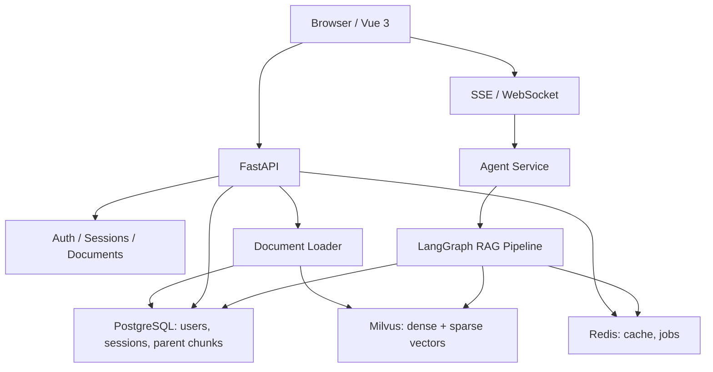

# PaperRAG

PaperRAG 是一个面向学术论文的 RAG 知识库平台，重点处理论文中的复杂版式、公式、定理、证明、引文和多轮问答溯源。

项目当前包含 FastAPI 后端、Vue 3/Vite 前端、Milvus 向量库、PostgreSQL、Redis，以及文档解析、混合检索、Agent 问答、RAG Trace 和异步文档任务等能力。

## 项目简介

功能状态口径：**已实现** = 在默认运行链路上生效；**部分实现** = 代码存在但有条件失效或未打通；**规划中** = 模块与测试存在，但无调用方接入，不产生用户可见能力。

| 能力 | 状态 | 说明 |
| --- | --- | --- |
| 学术文档解析（PDF/Word/Excel 加载、文本清洗、分块） | 部分实现 | 默认 PDF 结构分块路径只产叶级分块，缺层级父块（`document_loader.py:_split_structural`） |
| 学术结构识别（定理/证明/公式/引文/术语表） | 部分实现 | 提取器在分块期生效，但元数据未写入检索层（`milvus_writer.py` 字段映射不含这些列） |
| 混合检索（dense + sparse + Milvus hybrid + RRF） | 已实现 | 稀疏向量为**自实现 BM25**（`rag/embedding.py`），非 BGE-M3 原生 sparse |
| Rerank（双轨）、Context Expansion | 已实现 | 含定理优先与兄弟块扩展 |
| 查询改写（HyDE、Step-back、相关性评分与重检索） | 已实现 | `rag/rag_pipeline.py` |
| Agent 问答（LangGraph 工具调用、SSE/WebSocket） | 已实现 | SSE 目前**整段答案一次性下发**，非 token 级增量 |
| 引用展示、RAG Trace、会话历史 | 已实现 | 引用校验只验证 `[Source N]` 编号存在性，不做语义接地 |
| 公式感知检索 | 规划中 | 索引构建函数无任何调用点，检索分支恒返回空（`rag_utils.py:_build_formula_index`） |
| Auto-merging（父级分块合并） | 部分实现 | 默认 PDF 路径不产父块，合并数恒为 0；仅标准分块路径有效 |
| 多模态图表检索、ML 布局分析、论文知识图谱 | 规划中 | 模块与单元测试齐备，但未接入上传/检索链路；图谱三张表零写入 |
| 用户认证与权限 | 已实现 | JWT 分型校验、WebSocket 回查用户表、全局限流按 `RATE_LIMIT` 生效（A0-3）。前端未接 refresh 流程，访问令牌 60 分钟到期需重新登录 |
| 文档上传与任务进度 | 部分实现 | 任务状态默认存进程内存，重启即丢 |
| Docker Compose、健康检查、测试与 CI | 已实现 | 307 项测试为 mock 级，真实链路（上传→入库→问答）尚未被自动覆盖；前端 `typecheck` 已进 CI 门禁 |

> 上述断链的逐条证据见 [docs/refactor/00-audit.md](docs/refactor/00-audit.md) §3，重构路线见 [docs/refactor/](docs/refactor/)。

## 架构概览



更完整的架构梳理、优缺点与路线图见：

- [docs/architecture-review-and-improvement-plan.md](docs/architecture-review-and-improvement-plan.md)

## 技术栈

| 层级 | 技术 |
| --- | --- |
| 后端 | Python 3.12, FastAPI, SQLAlchemy, Alembic, SlowAPI |
| Agent/RAG | LangChain, LangGraph, Pydantic, sentence-transformers |
| 向量检索 | Milvus, dense vector, sparse BM25, RRF, rerank |
| 数据层 | PostgreSQL, Redis, MinIO, etcd |
| 前端 | Vue 3, Vite, TypeScript, vue-i18n, marked, KaTeX |
| 部署 | Docker, Docker Compose, Nginx |
| 测试 | pytest, pytest-asyncio, pytest-cov, ruff |

## 目录结构

```text
PaperRAG/
  backend/
    api/              HTTP/WebSocket 路由
    core/             配置、数据库、认证、依赖容器、日志、限流
    rag/              文档解析、Embedding、检索、RAG Graph
    services/         Agent、缓存、任务、工具服务
    agent/            新一代 LangGraph Agent 与引用校验
    vectordb/         Milvus 客户端与写入逻辑
  frontend/
    src/              Vue 3 + TypeScript 应用源码
    package.json      前端脚本与依赖
  docs/               架构、计划和评审文档
  tests/              单元测试与集成测试
  alembic/            数据库迁移
  docker-compose.yml  本地基础设施与后端服务编排
  pyproject.toml      Python 项目与测试配置
```

## 运行方式（快速开始）

### 1. 准备环境

需要：

- Python 3.12+
- Docker / Docker Compose
- 推荐使用 uv 管理 Python 依赖
- Node.js 20+ 用于前端开发

### 2. 安装后端依赖

```bash
uv sync
```

或使用 pip：

```bash
python -m venv .venv
source .venv/bin/activate
pip install -U pip
pip install -e ".[test]"
```

Windows PowerShell：

```powershell
python -m venv .venv
.venv\Scripts\Activate.ps1
pip install -U pip
pip install -e ".[test]"
```

### 3. 配置环境变量

```bash
cp .env.example .env
```

至少配置：

```env
LLM_API_KEY=your_api_key
LLM_BASE_URL=https://your-llm-endpoint/v1
LLM_MODEL=your_model
# 必填，缺失时应用拒绝启动；生成：python -c "import secrets; print(secrets.token_urlsafe(32))"
JWT_SECRET_KEY=
```

兼容旧变量：

```env
ARK_API_KEY=your_api_key
BASE_URL=https://your-llm-endpoint/v1
MODEL=your_model
```

### 4. 启动基础设施

```bash
docker compose up -d postgres redis etcd minio standalone attu
```

常用端口：

| 服务 | 端口 | 用途 |
| --- | --- | --- |
| PostgreSQL | 5432 | 用户、会话、父级分块、知识图谱 |
| Redis | 6379 | 缓存、任务状态 |
| Milvus | 19530 | 向量检索 |
| MinIO | 9000/9001 | Milvus 对象存储 |
| Attu | 8080 | Milvus Web 管理 |

### 5. 启动后端

```bash
uv run uvicorn backend.app:app --host 0.0.0.0 --port 8000 --reload
```

访问：

- 应用入口：http://127.0.0.1:8000/
- API 文档：http://127.0.0.1:8000/docs
- 健康检查：http://127.0.0.1:8000/health

### 6. 前端开发模式

```bash
cd frontend
npm install
npm run dev
```

构建：

```bash
npm run build
```

后端会优先挂载 `frontend/dist/`；如果不存在，则回退挂载 `frontend/`。

## 主要 API

| 方法 | 路径 | 说明 |
| --- | --- | --- |
| POST | `/api/v1/auth/register` | 注册 |
| POST | `/api/v1/auth/login` | 登录 |
| POST | `/api/v1/auth/refresh` | 刷新 token |
| GET | `/api/v1/auth/me` | 当前用户 |
| GET | `/api/v1/sessions` | 会话列表 |
| GET | `/api/v1/sessions/{session_id}` | 会话消息 |
| DELETE | `/api/v1/sessions/{session_id}` | 删除会话 |
| POST | `/api/v1/chat` | 同步聊天 |
| POST | `/api/v1/chat/stream` | SSE 流式聊天 |
| WS | `/api/v1/ws/chat?token=...` | WebSocket 流式聊天 |
| GET | `/api/v1/documents` | 文档列表 |
| POST | `/api/v1/documents/upload/async` | 异步上传文档 |
| GET | `/api/v1/documents/upload/jobs/{job_id}` | 查询上传任务 |
| POST | `/api/v1/documents/ingest` | 增量导入目录 |
| DELETE | `/api/v1/documents/delete/async/{filename}` | 异步删除文档 |
| POST | `/api/v1/cache/clear` | 清空缓存 |
| GET | `/api/v1/stats/usage` | 使用统计 |

## 测试与质量检查

```bash
uv run pytest
uv run pytest --cov=backend
uv run ruff check .
```

前端：

```bash
cd frontend
npm run typecheck
npm run build
```

## 当前已知问题

功能层面（证据见 [docs/refactor/00-audit.md](docs/refactor/00-audit.md)）：

- 公式感知检索、多模态图表检索、ML 布局分析、论文知识图谱：**代码存在但未接入任何运行链路**，不产生实际能力。
- 默认 PDF 解析路径不产出层级父块，导致 Auto-merging 恒不生效、`parent_chunks` 表近乎为空。
- 分块期提取的公式/引文/术语/章节元数据在写入 Milvus 时被丢弃。
- 叶子分块正文**只存在于 Milvus**，且字段为 `VARCHAR(2000)`，超长内容被截断。
- 上传任务状态默认存进程内存，重启即丢（`USE_REDIS_JOB_MANAGER=true` 可切到 Redis）。

安全基线：

- `ALLOWED_ORIGINS` 默认 `*`（生产校验会拒绝启动），上传大小上限默认 100MB，均需显式配置。
- 前端没有 refresh token 流程：访问令牌过期后直接登出，`/auth/refresh` 目前无调用方。
- 全局限流只覆盖 HTTP；WebSocket 走自带的每用户 10 条/60 秒计数，且不受 `RATE_LIMIT` 影响。
- 部署在自有反代之后时必须设 `TRUST_PROXY_HEADERS=true`，否则限流按代理 IP 计数，所有访客共用一个桶。

工程层面：

- `frontend/style.css`（1314 行）在拆分为 `src/assets/*.css` 后已成为**无人引用的孤儿文件**。
- 307 项测试全部为 mock 级，`chain`/`e2e` 两层尚未建立（见 [06-milestone-a0.md](docs/refactor/06-milestone-a0.md) A0-6）。

升级到本版本需要注意（A0-3 的启动行为变更）：

- `JWT_SECRET_KEY` 不再有默认值，缺失时应用**拒绝启动**；`ADMIN_INVITE_CODE` 未配置则注册接口不能创建 admin。
- `init_db()` 不再在 Alembic 失败时回退 `create_all`，迁移跑不起来即抛错。存量用 `create_all` 建表、
  没有 `alembic_version` 记录的库需要先人工补基准版本，再启动服务。
- `RATE_LIMIT` 现在真的生效（`APP_ENV=production` 默认 60/minute，开发环境默认关闭）。

详细分析与计划见 [架构评审与改进计划](docs/architecture-review-and-improvement-plan.md) 与 [重构 spec](docs/refactor/04-migration.md)。

## GitHub SSH 说明

如果使用多个 GitHub 账号，remote URL 需要匹配 `~/.ssh/config` 中的 Host 别名。例如：

```bash
git remote set-url origin git@github.com-creator:DGitHub-Creator/PaperRAG.git
```

测试：

```bash
ssh -T git@github.com-creator
```

## License

MIT
