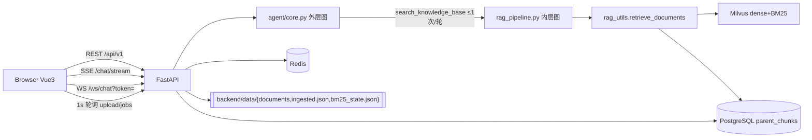

# 01 — 当前架构（As-Is）

> **本文状态（2026-10-09 复核）**：性质=**事实**（As-Is：Python 单体 + Vue 前端的现状快照）。里程碑口径一律用 **P0–P3**；旧 `Milestone A/B/C`、`A0-x` 的对应关系见 [04 §0/§3](04-migration.md)。本文描述的是**接管前**的形状；P1 起 13 条接口逐个由 Go 服务，接管进度与"哪些已经不一样了"以 [../progress.json](../progress.json) 为准，本文不逐条追改。
> 事实来源：[00-audit.md](00-audit.md)。本文件只描述**现状**，不含目标态。所有断言带 `文件:行`。

## 1. 进程与拓扑

单 Python 进程（FastAPI/uvicorn）同时承担：浏览器静态资源、REST API、SSE、WebSocket、Agent 编排、RAG 检索、PDF 解析、向量写入、任务执行（`BackgroundTasks` 线程池）。

| 容器 | 文件 | 端口 | 角色 |
| --- | --- | --- | --- |
| `backend` | `docker-compose.yml:94` | 8000 | 上述全部 |
| `postgres` | `:4` | 5432 | 业务库，默认库名 `langchain_app` |
| `redis` | `:21` | 6379 | 缓存 + 限流计数 + 可选任务状态 |
| `standalone` | `:70` | 19530 | Milvus |
| `etcd` / `minio` | `:35` / `:52` | — | Milvus 依赖 |
| `attu` | `:125` | 8080 | Milvus GUI |
| `nginx` | `Dockerfile` target `nginx`、`nginx/nginx.conf` | 80/443 | 静态 + `/api/` 反代 |

## 2. 后端包职责（62 模块）

| 包 | 职责 | 状态要点 |
| --- | --- | --- |
| `backend/api/` | 25 条路由 + 中间件挂载 | `routes.py` 仅聚合 documents/cache/stats |
| `backend/core/` | 配置(import 期读 env)、DB、JWT、依赖容器、日志、限流、指标、预算、异常 | `config/dev.py`、`config/prod.py` **从未被导入** |
| `backend/rag/` | 解析、清洗、分块、embedding、检索、RAG 图、父块存储、学术识别 6 个 extractor | 见 00-audit §3 断链 D1–D6 |
| `backend/agent/` | 外层 Agent 图、Pydantic schema、提示词、引用校验、eval | `verify.py` 只校验编号 |
| `backend/services/` | Agent 转发壳、语义缓存+Redis 缓存、会话存储、工具、上传任务 | `upload_jobs.py:102` 默认进程内存 |
| `backend/vectordb/` | Milvus schema/hybrid/写入 | 叶子块唯一正文存于此 |
| `backend/schemas/` | 请求响应模型 | `ChatResponse` 会静默丢字段 |

## 3. 完整对外契约表（25 条）

前缀：`auth/sessions/chat/api(routes)/ws` 挂 `/api/v1`；`health` + `/metrics` 挂根（`app.py:130-137`）。

| # | 方法 | 路径 | 鉴权 | 前端调用 | 触达 | 出处 |
| --- | --- | --- | --- | --- | --- | --- |
| 1 | GET | `/health` | — | ✗ | — | `health.py:92` |
| 2 | GET | `/ready` | — | ✗ | PG/Redis/Milvus 探活 | `health.py:121` |
| 3 | GET | `/metrics` | — | ✗ | Prometheus | `app.py:131` |
| 4 | POST | `/auth/register` | — | **✓** `useAuth.ts:45` | PG `users` | `auth.py:34` |
| 5 | POST | `/auth/login` | — | **✓** `useAuth.ts:34` | PG `users` | `auth.py:81` |
| 6 | GET | `/auth/me` | Bearer | **✓** `useAuth.ts:27` | PG | `auth.py:99` |
| 7 | POST | `/auth/refresh` | — | ✗ | PG | `auth.py:104` |
| 8 | GET | `/sessions` | Bearer | **✓** `useSessions.ts:25` | PG+Redis | `sessions.py:40` |
| 9 | GET | `/sessions/{id}` | Bearer | **✓** `:34` | PG+Redis | `sessions.py:21` |
| 10 | DELETE | `/sessions/{id}` | Bearer | **✓** `:43` | PG 级联+Redis | `sessions.py:54` |
| 11 | POST | `/chat` | Bearer | ✗ | LLM/Milvus/PG/Redis | `chat.py:20` |
| 12 | POST | `/chat/stream` | Bearer | **✓** `useChat.ts:116` | 同上 | `chat.py:53` |
| 13 | WS | `/ws/chat?token=` | query token | **✓** `useWebSocket.ts:14` | 同上 | `ws.py:54` |
| 14 | GET | `/documents` | admin | **✓** `useDocuments.ts:84` | Milvus `limit=10000` | `documents.py:384` |
| 15 | POST | `/documents/upload/async` | admin | **✓**（URL 缺前缀，坏的）`:143` | 磁盘+Milvus+PG+BM25 | `documents.py:410` |
| 16 | GET | `/documents/upload/jobs/{id}` | admin | **✓** `:116` | job store | `documents.py:453` |
| 17 | GET | `/documents/upload/jobs` | admin | ✗ | job store | `documents.py:461` |
| 18 | POST | `/documents/upload`（同步） | admin | ✗ | 同 15 | `documents.py:468` |
| 19 | DELETE | `/documents/delete/async/{filename}` | admin | **✓** `:226` | job store | `documents.py:543` |
| 20 | GET | `/documents/delete/jobs/{id}` | admin | **✓** `:192` | job store | `documents.py:567` |
| 21 | DELETE | `/documents/{filename}`（同步） | admin | ✗ | Milvus+PG+BM25+`ingested.json` | `documents.py:575` |
| 22 | POST | `/documents/ingest` | admin | ✗ | 目录扫描（仅 `*.pdf`） | `documents.py:599` |
| 23 | POST | `/cache/clear` | admin | ✗ | **仅进程内 SemanticCache** | `cache.py:15` |
| 24 | GET | `/stats/usage` | admin | ✗ | 进程内存 | `stats.py:15` |
| 25 | DELETE | `/stats/usage` | admin | ✗ | 进程内存 | `stats.py:20` |

**前端实际依赖 = 13 条**（#4、5、6、8、9、10、12、13、14、15、16、19、20）。其余 12 条无人调用 → 处置见 03-gap-analysis §5。

> 13 条 = 12 个 REST 操作 + 1 条 WS。**2026-10-09 复核**：`scripts/check_contracts.py` 从 `frontend/src`
> 现场抽取调用点，得到的集合与本表完全一致（不是照抄本表）；同时纠正了 #13、#20 两处的调用点行号。

## 4. 流式事件契约

SSE 帧格式 `data: <json>\n\n`，终止 `data: [DONE]\n\n`（`agent/core.py:393,428`）。WS 剥掉 `data: ` 前缀后原样透传，`[DONE]` 改写为 `{"type":"done"}`（`ws.py:98-106`）。

| `type` | 载荷 | 备注 |
| --- | --- | --- |
| `content` | `content: str` | **整段最终答案一次性下发，非 token 增量**（`core.py:379`） |
| `rag_step` | `step:{icon,label,detail}` | 检索过程可视化 |
| `citations` | `citations:[]`, `unsupported:[]` | `core.py:415` |
| `trace` | `rag_trace:{}`, 可选 `source_map:{}` | 仅非空才发 |
| `error` | `content: str` | |
| `done` | — | **仅 WS 存在**；SSE 靠流结束（`useChat.ts:155,168`） |

客户端→服务端：WS 为 `{"message": str, "session_id": str}`（`ws.py:81`）。

## 5. 配置清单（import 期读 env，无 pydantic-settings）

全量在 `backend/core/config/{auth,database,llm,embedding,retrieval,paths}.py`。**已确认的死配置**：`RETRIEVAL_COARSE_K`、`RERANK_TOP_N`、`RRF_K`、`ENABLE_HYDE`、`FAST_MODEL`、`AMAP_WEATHER_API`、`AMAP_API_KEY`（零引用）；`RATE_LIMIT`（仅日志，`default_limits=[]`）；`config/dev.py`、`config/prod.py`（从未导入）。

**绕过 config 直接读 env**：`HOST`/`PORT`（`app.py:165`）、`JSON_LOG`（`logging_config.py:32`）、`ENVIRONMENT`（`config/llm.py:7`）。

**危险默认值**：`JWT_SECRET_KEY="replace-with-strong-random-secret"`、`JWT_EXPIRE_MINUTES=1440`、`ADMIN_INVITE_CODE="paperrag-admin-2026"`、`ALLOWED_ORIGINS=["*"]` + `allow_credentials=True`（`app.py:92-98`）。

## 6. 中间件与响应形状

执行顺序（Starlette 后注册先执行，`app.py:66,105-126`）：`SlowAPIMiddleware` → `metrics` → `no_cache` → `stats`。`record_request` 记录**所有路径含静态资源**（`app.py:107`）。

三个必须在迁移期保持形状的语义：

1. 错误信封：As-Is 为"正常统一 `{"detail": ...}`，**429 例外**发 `{"error": "Rate limit exceeded: ..."}`（slowapi 默认 handler），422 发 FastAPI 校验数组"。两处例外已由决策 K1/K4 消除（2026-10-09 落地 `backend/core/exceptions.py`），现在全仓只剩 `{"detail": "<字符串>"}` 一种；定案后的表见 `contracts/error-codes.md` §2。
2. **无分页**：全仓无 `offset/page_size/total/has_more`，列表全量返回。
3. `rag_trace` **同一数据两种形状**：REST 经 pydantic `RagTrace`（`schemas.py:167`）过滤，SSE/WS 直发原始 dict（`rag_pipeline.py:183`）；且 `ChatResponse`（`schemas.py:251`）会丢弃 `run_agent` 返回的 `source_map`/`citations`/`unsupported`（`core.py:325-331`）。

## 7. 数据归属（As-Is）

| 实体 | 真相所在 | 备注 |
| --- | --- | --- |
| `users` | PG | 有 API |
| `chat_sessions`/`chat_messages` | PG（Redis 缓存 300s） | **覆盖式写**：`conversation_storage.py:80` 先 `.delete()` 再整批重插 |
| `parent_chunks` | PG（Redis Cache-Aside） | 只收 `chunk_level∈{1,2}`；PDF 默认路径不产 1/2 → 实际近空 |
| **叶子块正文** | **仅 Milvus**，`text VARCHAR(2000)` 会截断 | PG 无记录 |
| 文档清单 | Milvus 聚合 filename + `backend/data/ingested.json`（md5，无锁） | **无 documents/papers 关系实体** |
| BM25 词频 | `backend/data/bm25_state.json` | 与 DB 无事务关系 |
| 上传/删除任务 | 进程内存 dict（默认）/ Redis `paperrag:job:{id}` | 非持久；upload 与 delete 实例共用同一前缀 |
| 语义缓存 | 进程内 dict（阈值 0.92 / TTL 604800 / 500 条） | `/cache/clear` 只清它，不删 Redis |
| Milvus 集合 | `embeddings_collection` + `figure_embeddings`（无人用） | 无版本、无双副本、无别名切换；`drop_collection` 零调用 |

`ParentChunk` 的 docstring（`models.py:207-210`）声称 `0=叶, 1=父, 2+=更上层`，而 `document_loader.py` 实际发出 `1/2/3` 且 **3 才是叶**（`:366,391,415,559`），检索也按 `chunk_level==3` 过滤（`rag_utils.py:727`）——**文档语义与实现相反**，收编 schema 时必须以实现为准。

## 8. 启动与迁移链的真实行为

`app.py:77` `@app.on_event("startup")`（已 deprecated）→ `ensure_runtime_directories()` → `validate_config()` → `validate_runtime_security()` → `init_db()`。

`init_db()`（`core/database.py:99-120`）：先 `subprocess` 执行 `alembic upgrade head`，**rc≠0 或异常则 warning 后静默回退 `Base.metadata.create_all`**。→ 存量库可能没有 `alembic_version` 行；且重复启动对已有库执行 `create_all` 是"非破坏但不可信"的路径。处置见 05-database-migration §2。

Alembic：`21f6caf0b15b_init` → `add_workspaces` → `add_paper_knowledge_graph`，线性单 head；`env.py:18` 用 `config.DATABASE_URL` 覆盖 ini 占位符，`target_metadata=Base.metadata` 支持 autogenerate，但后两个迁移为手写。9 表列定义与迁移一致，漂移 3 处（索引/UNIQUE/时区），详见 00-audit §4。
